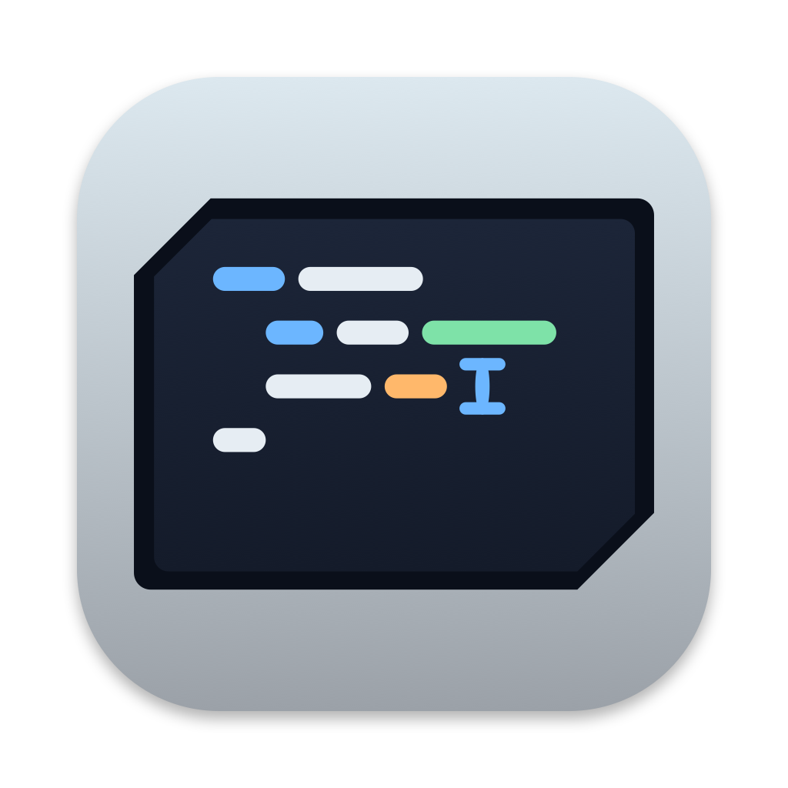

<p align="center"></p>

# Tekst

A native macOS text and code editor built with Qt Quick. *Tekst* is
Norwegian for "text".

Part of the [rask-project](https://github.com/rask-project) family, with
Konsoll and Metronom. See [docs/ROADMAP.md](docs/ROADMAP.md) for the plan.

## Building

Requires macOS 14.4+ (Apple Silicon), Qt 6.12, CMake 3.21+ and Ninja.

```sh
cmake -B build/Qt_6_12_0_for_macOS_Debug -G Ninja \
  -DCMAKE_PREFIX_PATH=/opt/Qt/6.12.0/macos -DCMAKE_BUILD_TYPE=Debug
cmake --build build/Qt_6_12_0_for_macOS_Debug
open build/Qt_6_12_0_for_macOS_Debug/Tekst.app
```

## License

MIT — see [LICENSE](LICENSE).
