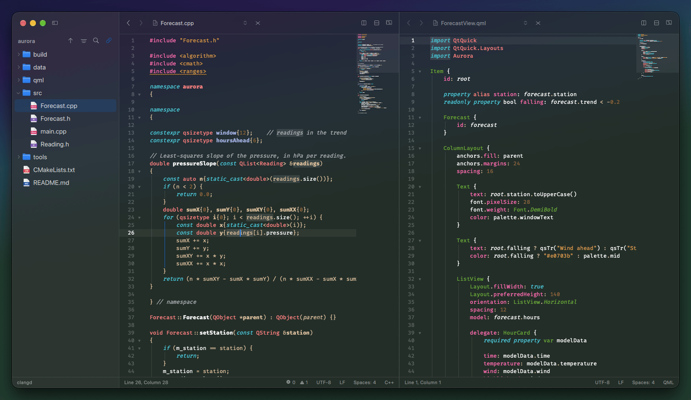
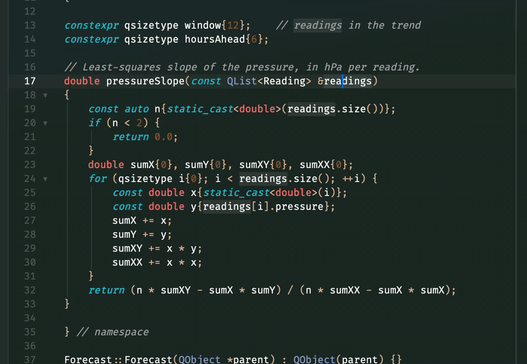
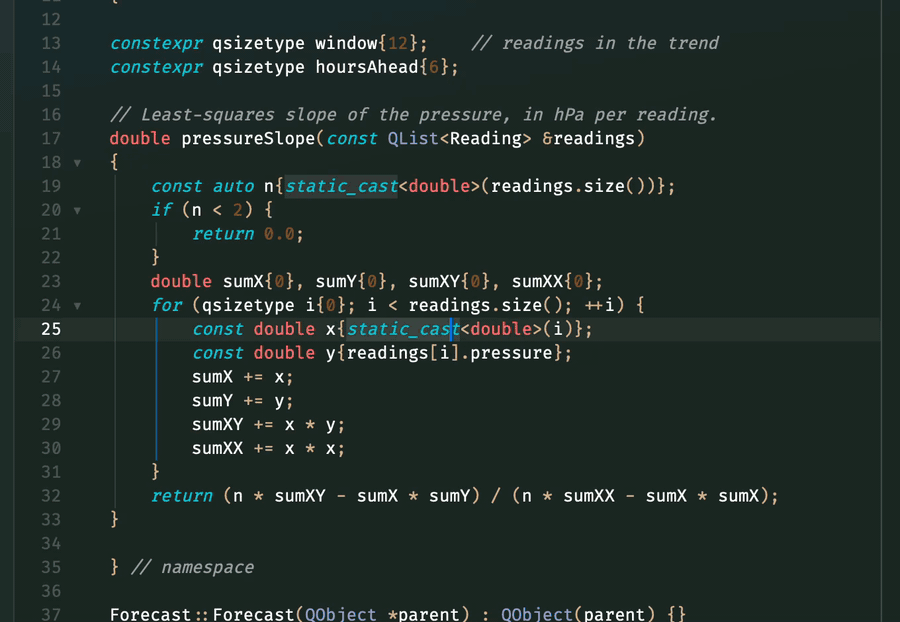
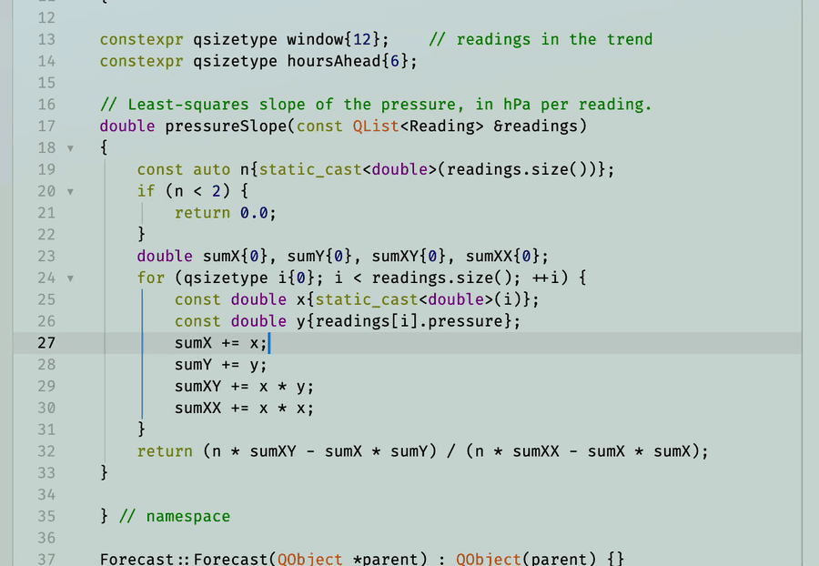
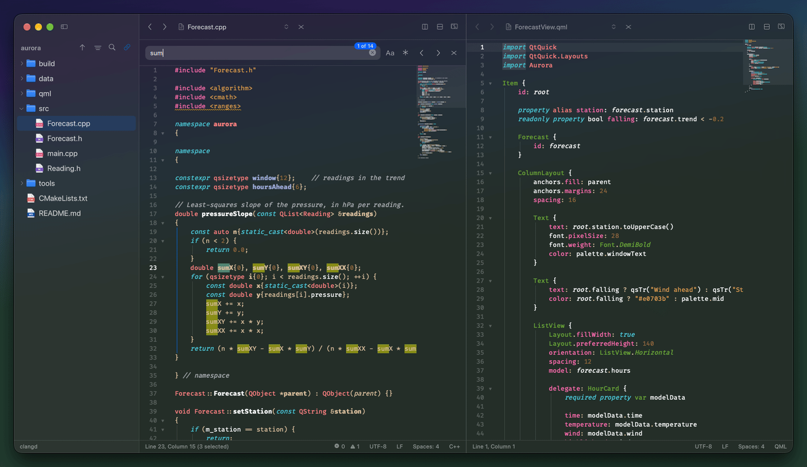
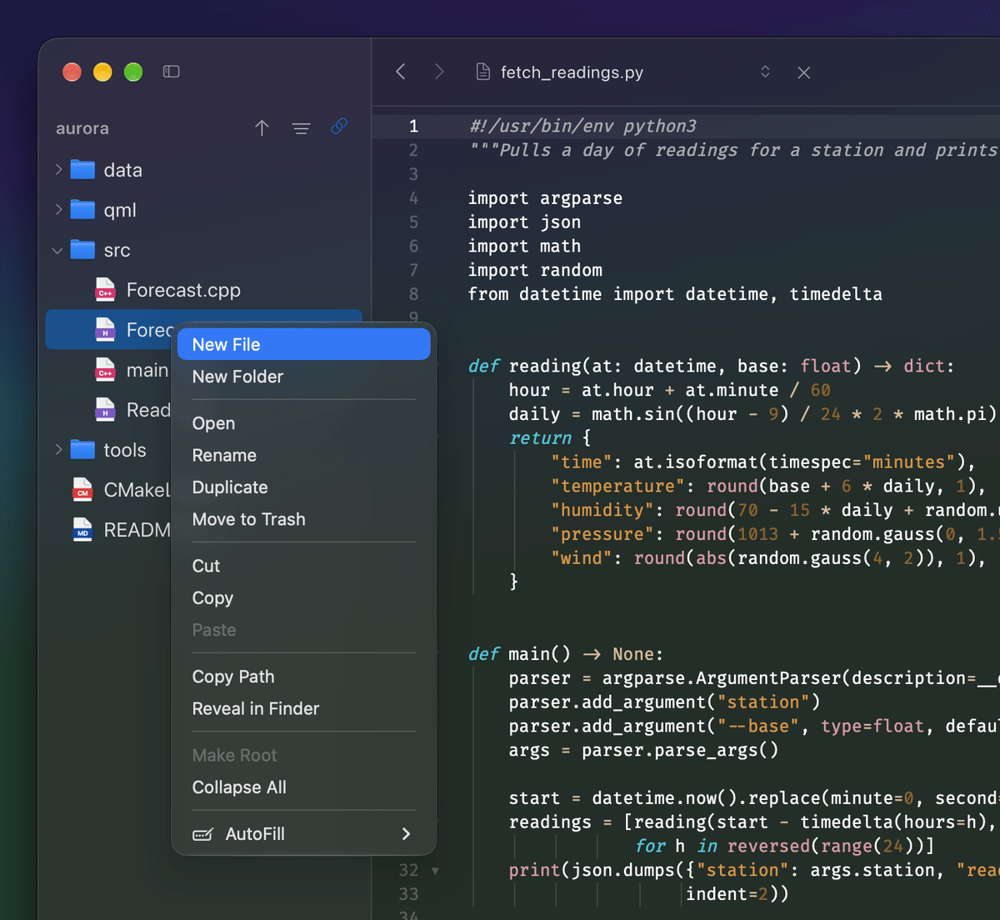
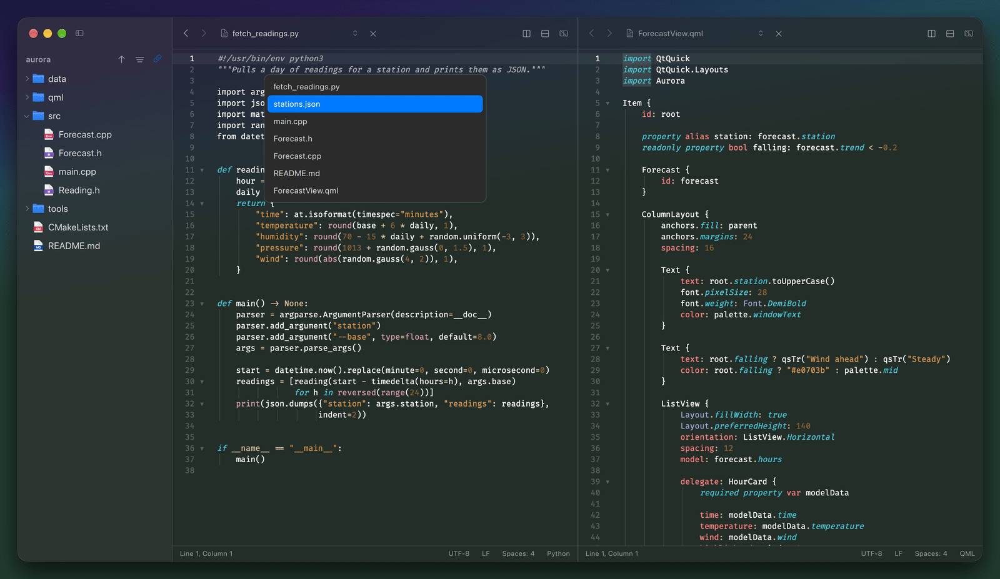
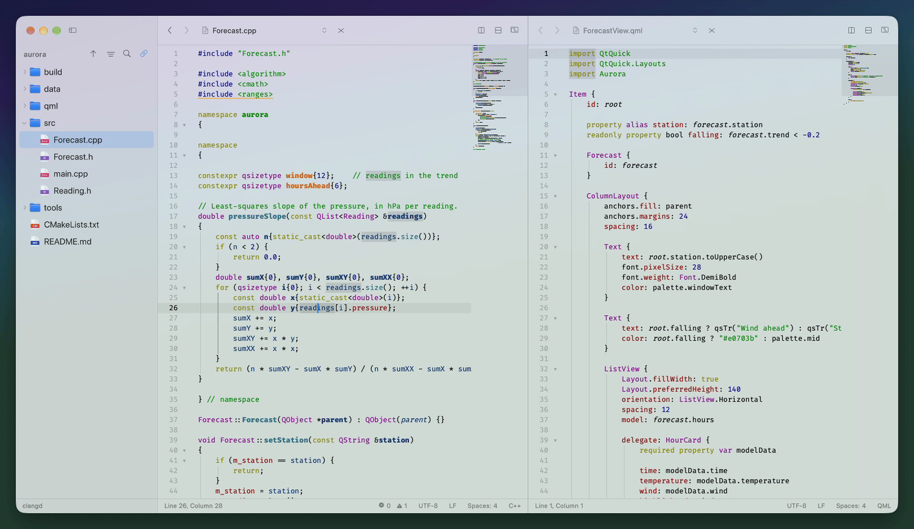
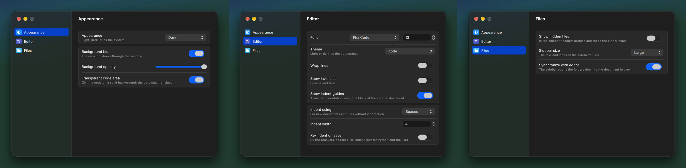

<p align="center"></p>

# Kode

A native text and code editor for macOS, built in QML (Qt Quick) and C++23.

**Website: [rask-project.github.io/kode](https://rask-project.github.io/kode/)**

Kode is a fast, native Mac editor. It has syntax highlighting for more than
300 languages, splits, multiple carets, code folding and a file sidebar, all
in a see-through window. Its editing surface is a C++ item that draws
straight into Qt Quick's scene graph and lays out only the lines in view, so
typing and scrolling cost the same in a 1 KB file and in a 100 MB one.

> Kode is Norwegian for "code".



Part of the [rask-project](https://github.com/rask-project) family with
[Konsoll](https://github.com/rask-project/Konsoll) and Metronom, sharing
their native macOS parts through the [Rask](https://github.com/rask-project/rask)
modules.

## Features

- **Syntax highlighting** for more than 300 languages with KDE's
  [KSyntaxHighlighting](https://invent.kde.org/frameworks/syntax-highlighting),
  detected by name and shebang, in themes that come as a light and a dark
  pair (Kode, Atom One, ayu, Breeze, GitHub, gruvbox, Solarized).
- **Splits, not tabs**, as in Qt Creator: split side by side or top and
  bottom, show the same document in two splits, go back and forward through
  what a split showed, and switch documents with <kbd>⌃Tab</kbd>.
- **Multiple carets**: <kbd>⌃D</kbd> adds the next occurrence, <kbd>⌥↑</kbd>
  <kbd>⌥↓</kbd> a caret above or below.
- **Code folding** by the language's regions or by indentation, and
  **Select Block** (<kbd>⌘U</kbd>), which grows the selection block by block.
- **A file sidebar** as Xcode's navigator: the Finder's icons and order, the
  file in view revealed, file operations in place.
- **Find and replace** with regular expressions, every match marked, and
  Replace All as one undo step.
- **Comments, indentation and re-indenting** by the language and the brackets.
- **Encodings and line endings** detected and kept, with 20 encodings to
  reopen or save with.
- **A Mac document app**: Open Recent, Open With and Open in Kode from the
  Finder, a sheet for unsaved changes, changes on disk reloaded, and the
  files each folder had open reopened with it; it can be the default editor.
- **A `kode` command** for the Terminal, as VS Code's `code`: `kode .`,
  `kode file`, even a file that doesn't exist yet.
- **Native look**: a translucent, blurred window, the system's accent and
  selection colors, SF Symbols, and light or dark.

### Multiple carets

Put the caret on a word and press <kbd>⌃D</kbd>: Kode selects it, then adds
each next whole-word occurrence with a caret of its own. Typing, deleting,
pasting and moving by word happen at every caret, as one undo step.
<kbd>⌥↑</kbd> / <kbd>⌥↓</kbd> add a caret on the line above or below
(<kbd>⌥⇧</kbd> for a block selection); <kbd>esc</kbd> goes back to one.



### Code folding

<kbd>⌥⌘←</kbd> folds the block at the caret and <kbd>⌥⌘→</kbd> opens it, as
in Xcode. You can also click the markers in the gutter. Blocks come from the
language's folding regions, or from indentation for Python and YAML. Going
to a hidden line opens its fold.



### Select Block

<kbd>⌘U</kbd> selects the lines inside the block at the caret, then the whole
block, then the one around it, as Qt Creator's Select Block Up.
<kbd>⇧⌘U</kbd> steps back.



### Find and replace

<kbd>⌘F</kbd> opens the find bar under the split's bar and <kbd>⌘R</kbd>
opens it with replace. It can match case and use regular expressions, with
`$0`…`$9` in the replacement. <kbd>⌘G</kbd> / <kbd>⇧⌘G</kbd> move between
matches, and <kbd>⌘L</kbd> goes to a line (`42` or `42:7`).



### Sidebar

Open a folder and it fills the window's sidebar (<kbd>⌃⌘S</kbd> hides it).
The right-click menu has New File, New Folder, Rename, Duplicate, Move to
Trash, Cut, Copy and Paste (with the Finder too), Copy Path and Reveal in
Finder. Documents that are open follow the files you rename or move.

<p align="center"></p>

### Switching documents

<kbd>⌃Tab</kbd> lists every open document, the split's most recent first.
Keep <kbd>⌃</kbd> held and press <kbd>Tab</kbd> to move down the list;
releasing <kbd>⌃</kbd> shows the selected document.



### Light and dark

The window follows the app's appearance (light, dark or as the system), and
so does the theme's version.



### Settings

<kbd>⌘,</kbd> opens Settings:

- **Appearance**: the appearance, the window's blur and opacity, and a
  transparent code area.
- **Editor**: the font, the theme, wrapping, invisibles, indent guides,
  indentation for new documents and re-indenting on save.
- **Files**: hidden files, the sidebar's size and syncing it with the editor.



## Keyboard

| Keys | Action |
| --- | --- |
| <kbd>⌘N</kbd> / <kbd>⇧⌘N</kbd> | New document / new window |
| <kbd>⌘W</kbd> / <kbd>⇧⌘W</kbd> / <kbd>⌥⌘W</kbd> | Close document / all documents / the window |
| <kbd>⌘D</kbd> / <kbd>⇧⌘D</kbd> / <kbd>⌥⌘D</kbd> | Split side by side / top and bottom / remove split |
| <kbd>⌃Tab</kbd> | Switch documents |
| <kbd>⌃⌘←</kbd> / <kbd>⌃⌘→</kbd> | Back / forward |
| <kbd>⌃⌘S</kbd> | Show or hide the sidebar |
| <kbd>⌘F</kbd> / <kbd>⌘R</kbd> / <kbd>⌘G</kbd> / <kbd>⌘E</kbd> | Find / replace / next match / use selection |
| <kbd>⌘L</kbd> | Go to line |
| <kbd>⌃D</kbd>, <kbd>⌥↑</kbd> / <kbd>⌥↓</kbd> | Add a caret |
| <kbd>⌘U</kbd> / <kbd>⇧⌘U</kbd> | Select block / step back |
| <kbd>⌘/</kbd> / <kbd>⌥⌘/</kbd> | Line / block comment |
| <kbd>⌥⌘←</kbd> / <kbd>⌥⌘→</kbd> | Fold / unfold |
| <kbd>⌘[</kbd> / <kbd>⌘]</kbd> / <kbd>⌃I</kbd> | Outdent / indent / re-indent |
| <kbd>⌘+</kbd> / <kbd>⌘-</kbd> / <kbd>⌘0</kbd> | Bigger / smaller / actual size |

## Performance

Kode's `EditorView` was measured against Qt Quick's `TextEdit` (Release
build, Apple M1):

| | 1 MB | 10 MB | 100 MB |
| --- | ---: | ---: | ---: |
| Open to first frame | 32 ms | 33 ms | 83 ms |
| Worst keystroke | 13.4 ms | 13.2 ms | 12.9 ms |
| Memory | 3 MB | 9 MB | 32 MB |
| *TextEdit, open* | *483 ms* | *4.9 s* | *19.6 s* |

The method and every number are in [docs/editor-bench.md](docs/editor-bench.md).

## Install

Download `Kode-VERSION-arm64.dmg` (or `.zip`) from the
[Releases](https://github.com/rask-project/kode/releases) page and move
**Kode** to `/Applications`. Requires macOS 14.4+ on Apple Silicon.

The app is ad-hoc signed but not notarized by Apple, so Gatekeeper blocks the
first launch. Clear the quarantine flag once:

```sh
xattr -dr com.apple.quarantine /Applications/Kode.app
```

or open it, then choose **System Settings → Privacy & Security → Open
Anyway**.

### Updates

Kode updates itself: once a day it looks for a newer release, downloads it
in the background and installs it when you quit. **Kode ▸ Check for
Updates…** checks right away. **Settings ▸ Updates** turns the automatic
checks and downloads off and picks the channel: **Stable only** (the
default) or **Stable and beta**. Updates are signed, and they open without
the quarantine step above. (1.0.0 predates the updater: install the next
release by hand once.)

### The `kode` command

As VS Code's `code`: **Settings ▸ Files ▸ Command line tool ▸ Install**
links `/usr/local/bin/kode` to the script inside the app (macOS asks for
your password once). Then, in the Terminal:

```sh
kode .              # the current folder in the sidebar
kode src/main.cpp   # a file, in the running Kode
kode notes/new.md   # a file that does not exist yet: written when you save
```

### The Finder

Release builds offer Kode in **Open With** for text and code files and
folders, and add **Open in Kode** to the Finder's right-click menu (under
Quick Actions or Services). **Settings ▸ Files ▸ Default editor ▸ Make
Default** makes Kode open text and code files on a double click. Debug
builds leave all this out, so a development copy doesn't show up twice
next to the installed app (`-DKODE_FINDER_INTEGRATION=ON` turns it on).

## Building

Requires Qt 6.12, CMake 3.21+, Ninja and the Xcode command-line tools (a
C++23 compiler). KDE's Extra CMake Modules and KSyntaxHighlighting are
submodules, built once when the project is configured.

```sh
git clone --recurse-submodules https://github.com/rask-project/kode.git   # or: git submodule update --init
cd kode
cmake -B build/Qt_6_12_0_for_macOS_Debug -G Ninja \
  -DCMAKE_PREFIX_PATH=/opt/Qt/6.12.0/macos -DCMAKE_BUILD_TYPE=Debug
cmake --build build/Qt_6_12_0_for_macOS_Debug
ctest --test-dir build/Qt_6_12_0_for_macOS_Debug --output-on-failure
open build/Qt_6_12_0_for_macOS_Debug/Kode.app
```

`--target package-macos` makes the self-contained bundle in
`build/…/dist/Kode.app`; [docs/RELEASE.md](docs/RELEASE.md) covers releases.
[docs/ROADMAP.md](docs/ROADMAP.md) has the plan, and [AGENTS.md](AGENTS.md)
has the project's layout and rules. [docs/SCREENSHOTS.md](docs/SCREENSHOTS.md)
explains how the images above are taken. The website lives in [site/](site/).

## License

MIT — see [LICENSE](LICENSE).
